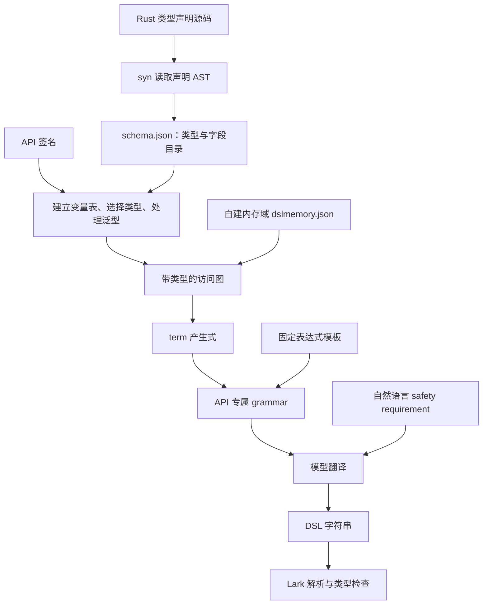

# 从 Rust 源码到 DSL grammar：用一个例子讲清楚

本文面向没有编译器背景的读者。我们只围绕一个真实例子，说明每一步读入什么、生成什么，以及 **AST 中的一个字段为什么会变成 grammar 中的一条规则**。

最终要得到的表达式是：

```text
$2.start <= $2.end
```

这条表达式的含义是：“第二个 API 参数的 start 不大于它的 end。”

先记住各部分的分工：**程序从源码中确定可以访问哪些字段；模型根据自然语言要求，决定如何组合这些访问和运算。**

## 1. 我们想解决什么问题

这次选择的是 `rules.csv` 中的 **rule-40**：

> The range must be canonical, with `initialized.start <= initialized.end`.

可以直接理解成：传入的范围必须满足 `initialized.start <= initialized.end`。

对应的 API 是 `IntoIter<T, N>::new_unchecked`。它接收的两个参数是：

```rust
buffer: [MaybeUninit<T>; N]
initialized: Range<usize>
```

其中：

- `buffer` 是有 N 个元素的数组。
- `initialized` 是一个范围，例如 `2..5`。
- `usize` 是 Rust 的一种非负整数类型。
- `T` 是类型参数，表示元素的类型。
- `N` 是 const 泛型参数，表示一个编译期整数。

本次传给工具的 API 描述如下。它省略了返回值，所以本次变量表只包含参数和泛型：

```text
core::array::IntoIter::<T,N>::new_unchecked(
    buffer: [core::mem::MaybeUninit<T>; N],
    initialized: core::ops::Range<usize>
)
```

工具需要知道 `initialized` 的类型有 `start`、`end` 两个字段，并允许模型使用它们来表达上面的安全要求。

这些字段来自 Rust 类型声明。字段之间必须满足什么关系，则来自自然语言 rule。

## 2. 先认识五个词

| 术语 | 在本文中的含义 | 例子 |
| --- | --- | --- |
| 源码 | 人写的程序文本 | `pub start: Idx` |
| AST | 程序解析源码后得到的、有结构的语法树 | 一个“字段节点”，记录名字 start 和类型 Idx |
| schema | 保存类型结构的统一数据格式，这里使用 JSON | Range 有哪些字段、各字段是什么类型 |
| term | DSL 中表示一个值或观察视图的表达式 | `$2`、`$2.start`、`$4` |
| grammar | 规定哪些表达式文本可以组成这门 DSL 的规则集合 | `usize_term = range_term, ".", "start";` |

`range_term` 叫作**非终结符**，可以把它理解成一个表达式类别：“所有结果类型是 Range 的 term”。它不是程序里的某个变量，也不是 Range 的字段。

`$2` 则是具体表达式文本，表示本次 API 的第二个参数。

## 3. 整个过程的路线图



**从 Rust 声明到 grammar 的部分由确定性程序完成。** 模型在 grammar 生成之后才参与，将自然语言要求翻译成 DSL。

当前实现有两个阶段：给模型看的 grammar 使用有限的泛型抽象；返回后，检查器再按具体类型构造精确的访问规则。下面先用具体类型解释转换的基本原理，第 13 节再说明这两个阶段的区别。

## 4. 第一步：找到 Range 的源码声明

本例用到的声明位于 [core/src/ops/range.rs](../tools/rust/library/core/src/ops/range.rs)。省略文档和属性后，结构是：

```rust
pub struct Range<Idx> {
    pub start: Idx,
    pub end: Idx,
}
```

这段声明提供了三个关键事实：

1. 类型名字是 `Range`。
2. 它有一个类型参数 `Idx`。这个名字暂时代表一种尚未指定的类型。
3. 它有 `start` 和 `end` 两个字段，两个字段的类型都是 `Idx`。

例如 `Range<usize>` 表示把这里的 `Idx` 指定为 `usize`。

此时还没有一个具体的范围对象，也不知道 start、end 的具体数值。我们读到的是“这种对象的结构”。

## 5. 第二步：源码文本变成 AST

源码最初是一串字符。`syn` 这样的 Rust 语法解析库，会把它识别成有标签、有层次的节点。

上面的声明可以用下面这棵树理解：

```text
Struct：结构体声明
├── 名字：Range
├── 泛型参数
│   └── 类型参数：Idx
└── 命名字段
    ├── Field：字段声明
    │   ├── 名字：start
    │   └── 类型：路径 Idx
    └── Field：字段声明
        ├── 名字：end
        └── 类型：路径 Idx
```

这是便于阅读的 AST 缩略图，不是 `syn` 的原样调试输出。实际节点包含更多信息，例如可见性、属性和源码位置。

有了这棵树，程序就可以可靠地询问：

```text
这个节点是不是 struct？
struct 的名字是什么？
它有哪些字段？
每个字段的名字和类型是什么？
```

字段名 `start`、`end` 来自节点中的标识符。字段类型 `Idx` 来自节点中的类型信息。它们都不需要模型猜测。

当前的声明读取器使用 `syn` 读取 struct、enum、type alias 等声明，并跳过函数和 impl 的函数体；它没有运行 Rust 函数，也不使用 rustc HIR。

相关实现是 [surface.rs](../tools/dslgen/src/surface.rs) 和 [lib.rs](../tools/dslgen/src/lib.rs)。

## 6. 第三步：把需要的 AST 信息保存成 schema

完整 AST 会包含许多生成访问语法用不到的信息。工具将所需部分整理成统一的 JSON 类型目录。

例如，Range 对应的目录项可以缩略为：

```json
{
  "name": "core::ops::range::Range",
  "parameters": [
    {
      "name": "Idx",
      "kind": "type",
      "const_type": null,
      "default": null
    }
  ],
  "shape": {
    "kind": "record",
    "fields": [
      {
        "name": "start",
        "ty": {"kind": "parameter", "name": "Idx"}
      },
      {
        "name": "end",
        "ty": {"kind": "parameter", "name": "Idx"}
      }
    ],
    "tuple": false
  }
}
```

这里省略了源码位置和条件属性，保留了实际使用的字段名称与结构。

这一步可以理解成：

```text
AST 中的 struct 名字       → schema.name
AST 中的泛型参数          → schema.parameters
AST 中的每个字段          → schema.shape.fields 中的一项
AST 中的字段名字和类型    → 该项的 name 和 ty
```

`core::ops::range::Range` 是规范名称，用于区分可能同名的类型。API 中常见的 `core::ops::Range` 可以通过已解析的 import/re-export 映射到这个定义。

生成的通用目录位于 [tools/x/generated/dsl/schema.json](../tools/x/generated/dsl/schema.json)。它可由多个 API 共用，尚未绑定本例的 `$1`、`$2`。

完整目录的顶层内容是：

| 字段 | 用途 |
| --- | --- |
| `version` | 数据格式版本 |
| `definitions` | 上述类型定义的集合 |
| `selectors` | 下一节介绍的类型访问边 |
| `aliases` | 已解析的 import/re-export 名称映射 |
| `alternatives` | 配置未确定时的重复定义候选 |
| `files` | 扫描过的文件 |
| `diagnostics` | 声明解析问题 |
| `unexpanded_macros` | 尚未展开的宏位置 |

## 7. 第四步：每个字段变成一条“带类型的访问边”

为了统一处理字段、数组元素和 enum payload，工具把各种取值操作表示成相同形式：

```text
接收者类型 ── 访问操作 ──▶ 结果类型
```

对本例，遍历 AST 中的两个字段就得到：

```text
Range<Idx> ── .start ──▶ Idx
Range<Idx> ── .end   ──▶ Idx
```

第一条边表示：如果一个表达式得到的是 `Range<Idx>`，那么在它后面接 `.start`，结果类型就是 `Idx`。

它在 `selectors` 中保存成如下形式，省略源码位置：

```json
{
  "core::ops::range::Range": [
    {
      "syntax": ".start",
      "result": {"kind": "parameter", "name": "Idx"},
      "guard": null
    },
    {
      "syntax": ".end",
      "result": {"kind": "parameter", "name": "Idx"},
      "guard": null
    }
  ]
}
```

`definitions` 保存声明的结构；`selectors` 将声明整理成便于遍历的访问关系。

不同源码结构遵循固定的转换规则：

| 源结构 | 生成的访问关系 |
| --- | --- |
| 命名字段 `S.f: U` | `S ── .f ──▶ U` |
| tuple 字段 | `Tuple ── [i] ──▶ 第 i 个字段的类型` |
| array/slice 元素 | `Sequence<U> ── [index] ──▶ U` |
| enum 数据 variant | `Enum ── .Variant ──▶ Payload`，附带 variant guard |
| enum unit variant | 生成合法的 variant tag，没有 payload 访问 |
| Rust `type A = U` | 透明地使用 U 的类型视图，不增加字段访问 |

数组、slice 和 tuple 的元素访问还会由 Python 根据语言类型构造器补充。enum payload 的使用需要匹配的 `is_variant` 条件。

声明到选择器的实现位于 [catalog.rs](../tools/dslgen/src/catalog.rs)。

## 8. 第五步：确定本次 API 的变量和具体类型

工具接下来解析 API 描述，建立固定变量表：

| DSL 名字 | 源名字 | 类型/含义 |
| --- | --- | --- |
| `$1` | `buffer` | `[MaybeUninit<T>; N]` 数组值 |
| `$2` | `initialized` | `Range<usize>` 范围值 |
| `$3` | `T` | 类型参数的信息句柄，当前为不透明入口 |
| `$4` | `N` | const 参数的 usize 数值 |

这里的 `$2` 是 API 输入的编号，不是 AST 节点编号。变量表由程序建立，模型使用这个固定编号。

本次 API 明确指定 `initialized: Range<usize>`，因此 Range 定义中的类型参数被替换为：

```text
Idx := usize
```

带类型的访问关系随之变成：

```text
Range<usize> ── .start ──▶ usize
Range<usize> ── .end   ──▶ usize
```

同时，工具按 API 选择类型及其依赖，然后从实际输入类型出发构造可达访问关系。基础类型 `usize` 由类型引擎直接识别，无需寻找一个同名 struct。

相关实现是 [dslapi.py](../tools/x/src/dslapi.py) 和 [dsltypes.py](../tools/x/src/dsltypes.py)。

## 9. 第六步：访问边变成 grammar 产生式

这是 AST 到 grammar 过程中最关键的一步。

### 9.1 为每一种结果类型建立表达式类别

我们建立两个类别：

```text
range_term：结果类型为 Range<usize> 的表达式
usize_term：结果类型为 usize 的表达式
```

根据变量表，`$2` 是一个范围值，`$4` 是一个整数值，因此加入：

```ebnf
range_term = "$2" ;
usize_term = "$4" ;
```

这里几个符号的意思是：

| 符号 | 含义 |
| --- | --- |
| `=` | 定义一条语法规则 |
| `"$2"` | 要求文本中出现字面量 `$2`，实际 DSL 不包含引号 |
| `range_term` | 一个可继续展开的表达式类别 |
| `,` | 将两段文本按顺序连接，实际表达式不因此增加逗号 |
| `|` | 选择其中一种写法 |
| `;` | 结束这条 grammar 规则 |

### 9.2 每条访问边贡献一个新的表达式写法

我们已经知道：

```text
Range<usize> ── .start ──▶ usize
```

因此，“一个 range_term 后面接上 `.start`”就是一种新的 usize_term：

```ebnf
usize_term = range_term, ".", "start" ;
```

`.end` 同理：

```ebnf
usize_term = range_term, ".", "end" ;
```

**产生式左侧按访问结果的类型分组。** `.start` 得到整数，所以它贡献给 `usize_term`。

将同一类别的几种写法合并，就得到：

```ebnf
range_term = "$2" ;

usize_term = "$4"
           | range_term, ".", "start"
           | range_term, ".", "end" ;
```

这段是用于说明核心关系的简化 grammar。实际生成版本还允许括号，并包含数组、内存视图等其他产生式。

### 9.3 统一转换规则

把类型称作 A、B，把某个访问操作称作 s，那么规则始终是：

```text
输入：A ── s ──▶ B

输出：B_term = A_term, s 的字面量记号 ;
```

例如 `Container.child: Child`，以及 `Child.length: usize`，会机械地产生：

```ebnf
child_term = container_term, ".", "child" ;
usize_term = child_term, ".", "length" ;
```

这样就可以组合出多级访问 `container.child.length`。不需要为每条多级路径手写规则。

同一个类型可以被多处引用，递归关系也通过引用保存。因此工具处理的是类型图，而非不断复制展开的树。

图到产生式的实现位于 [dslgrammar.py](../tools/x/src/dslgrammar.py)。

## 10. 第七步：加入比较等表达式模板，得到 formula

到这里，我们知道哪些取值表达式合法，但还需要表达“两个值之间有什么关系”。

固定表达式模板提供比较、算术、布尔逻辑、列表推导等语法。本例只需要比较运算。

为了看清连接方式，可以先看一个只支持本例的教学版 grammar：

```ebnf
formula = comparison ;

comparison = usize_term, "<=", usize_term ;

range_term = "$2" ;

usize_term = "$4"
           | range_term, ".", "start"
           | range_term, ".", "end" ;
```

它可以这样展开：

```text
formula
  → comparison
  → usize_term <= usize_term
  → range_term.start <= range_term.end
  → $2.start <= $2.end
```

展开过程中的箭头表示“用一个类别允许的写法替换它”。真正出现于最终 DSL 的字符只有最后一行。

实际模板比这个教学版丰富。相同的产生式数据会分别输出人可读的 EBNF 和可执行的 Lark grammar，供解析器识别返回文本。

## 11. 第八步：模型根据 rule 选择一个公式

模型收到三类信息：

1. API 描述及固定的 `$n` 变量说明。
2. 上一步生成的 API 专属 grammar，以及内存域的明确定义。
3. 自然语言 safety requirement。

本例的自然语言要求包含：

```text
initialized.start <= initialized.end
```

模型将 `initialized` 对应到 `$2`，返回：

```text
$2.start <= $2.end
```

**grammar 提供表达能力和访问约束；自然语言 rule 提供需要表达的条件。** 仅从 Range 有 start/end 两个字段，无法推导出这个 API 要求它们满足 `<=`。

如果完整要求所需的观察或操作没有定义，模型应返回固定标记 `UNEXPRESSIBLE`。模型的成功输出是 DSL 原文，不带 JSON 包装。

## 12. 第九步：解析和类型检查

当前实现会把 `$2` 转成仅供内部检查使用的名字，读取候选表达式的结构，再构造精确的访问 grammar，使用 Lark 解析并进行类型检查。

候选公式可以理解为另一棵 AST：

```text
Compare：比较
├── 左侧：读取 $2 的 start 字段
├── 运算符：<=
└── 右侧：读取 $2 的 end 字段
```

这棵树描述的是 **DSL 表达式**。第 5 节的 AST 描述的是 **Rust 源码声明**。两者处于不同阶段。

检查器验证：

```text
$2 的类型是 Range<usize>
Range<usize> 声明了 start 和 end
两个字段的结果类型都是 usize
<= 的两个操作数可以进行整数比较
整个表达式的结果是 Boolean
```

几个反例有助于理解分工：

| 候选表达式 | 问题 |
| --- | --- |
| `$2.capacity <= $2.end` | Range 没有 capacity 访问边 |
| `$1.start <= $2.end` | `$1` 是数组，不是 Range，不能接 .start |
| `$2 + 1` | 在完整表达式模板中，还需由类型检查拒绝对范围对象做整数加法 |
| `$2.end` | 在完整模板中可作为整数 term，但不是最终要求的 Boolean formula |

本例已有实际运行记录，检查结果为：

```json
{
  "generated_grammar": "passed",
  "syntax_and_schema": "passed",
  "semantic_fidelity": "not_verified"
}
```

这些检查说明表达式符合提供的结构和类型规则。它们不证明模型完全保留了自然语言语义，也没有验证某次真实 Rust 执行。

为了理解公式的含义，可以手算：如果 initialized 的 start 为 2、end 为 5，公式为真；如果 start 为 7、end 为 3，公式为假。本次翻译记录没有提供这两个具体对象，也没有执行 API 来取得它们。

相关实现在 [dsltrans.py](../tools/x/src/dsltrans.py)；Python AST 和 Lark 均用于读取、检查表达式，不通过 Python `eval` 执行它。

## 13. 当前实现里需要知道的两个边界

### 13.1 给模型看的 grammar 和检查阶段的 grammar

上面的说明用具体的 `Range<usize>` 展示了基本算法。当前实现为了避免递归泛型无限增长，给模型的 prompt grammar 使用 declaration-family 抽象。

所以实际 prompt 文件里可能看到：

```text
Range<Idx> ── .start/.end ──▶ Idx
```

模型返回候选表达式之后，检查阶段再使用具体参数：

```text
Range<usize> ── .start/.end ──▶ usize
```

检查阶段的非空访问路径展开深度受候选表达式的字段/下标访问数量限制，另外还有类型展开与别名遍历上限。

泛型抽象可能遗漏某些合法的嵌套访问路径。当前实现不能宣称“无损生成了所有合法泛型访问语法”或“覆盖了全部 Rust safety requirement”。本例中用到的 start/end 路径已实际验证通过。

### 13.2 `$mem` 来自单独建模的域

Rust 的 Range AST 没有 `$mem` 字段。内存视图由 [dslmemory.json](../tools/x/src/dslmemory.json) 明确定义，再注入相同的类型访问图：

```text
Range<usize> ── .$mem ──▶ MemoryStorage<Range<usize>>
MemoryStorage<Range<usize>> ── .size ──▶ MemoryInteger
```

因此，下列两个 term 表示不同的事情：

| term | 含义 |
| --- | --- |
| `$2.end` | Range 里的结束索引字段 |
| `$2.$mem.end` | Range 对象自身存储视图的结束字节地址 |

本例的 rule 需要第一种含义。类型信息足以把第二种观察语法加入 grammar，但不会因此让它成为本条 rule 应使用的条件。

已知指针类型还可以访问 `p.$mem.pointee`，表示指针指向区域的内存视图。详细语义见 [内存域说明](../tools/x/dslmemory.md)。这些字段是规格观察接口，目前尚未绑定 KLEE 运行时。

## 14. 把核心算法压缩成伪代码

以下展示算法结构；具体的泛型终止策略见上一节。

```text
输入：Rust 类型声明源码、API 描述、自建内存域、固定表达式模板

AST := 用 syn 读取类型声明

对每个支持的声明：
    保存类型名、泛型参数、字段/variant 结构
    把每个可访问位置转换成“接收者类型 -- 选择器 --> 结果类型”

schema := 保存这些定义、选择器和名称映射

变量表 := 从 API 建立 $1、$2……及其类型
选取 API 相关声明及其依赖

用工作队列遍历输入类型：
    按当前策略处理泛型参数、别名和访问结果类型
    保存类型节点和访问边
    为适用的 Rust 值类型加入内存域访问边
    复用已经处理过的类型节点

为每个可达类型建立一个 term 非终结符

对每个变量 $i，类型为 A：
    添加 A_term = "$i"

对每条访问边 A -- s --> B：
    添加 B_term = A_term, s 的字面量记号

加入固定表达式模板，连接到 formula 起始规则
去除不可达产生式
输出 EBNF 和 Lark 使用的产生式表示

模型 := 使用 grammar 和变量表翻译自然语言 rule
检查候选 DSL 的语法、字段访问、操作数类型、作用域与必要 guard
```

这段伪代码中，AST 的作用是提供字段等**结构事实**；访问图将这些事实统一起来；grammar 将访问图变成可以生成和识别的表达式文本。

## 15. 实际复现时的命令与文件

以下命令在仓库根目录执行。按照仓库要求，生成和翻译均运行在项目 Docker 环境中：

```sh
dsl_docker() {
  docker build --platform linux/amd64 --build-arg "USER_ID=$(id -u)" --build-arg "GROUP_ID=$(id -g)" -t unsat-rust:local . || return
  docker run --rm --platform linux/amd64 -i -e PYTHONPATH=/unsat-rust/tools/x/src \
    -v "$PWD:/unsat-rust" -w /unsat-rust \
    -v "$PWD/.local/cargo-home/registry:/home/user/.cargo/registry" \
    -v "$PWD/.local/cargo-home/git:/home/user/.cargo/git" \
    unsat-rust:local "$@"
}
```

先生成通用类型目录：

```sh
dsl_docker cargo run --locked --manifest-path tools/dslgen/Cargo.toml
```

输出文件为 `tools/x/generated/dsl/schema.json` 和 `selectors.md`。通用 EBNF 已移除，具体 API 的语法由 Python 从 schema 生成。

接着准备本例输入：

```sh
dsl_docker python - <<'PY'
import json
from pathlib import Path

out = Path("eval/dsltrans/dslgen-doc-example")
out.mkdir(parents=True, exist_ok=True)
rows = json.loads(Path("tools/x/dsltrans_samples.json").read_text())
case = next(row for row in rows if row["id"] == "rule-40")
(out / "cases.json").write_text(json.dumps([case], indent=2) + "\n")
PY
```

只生成变量表、裁剪目录、grammar 和 prompt，不调用模型：

```sh
dsl_docker python tools/x/src/dsltrans.py \
  --dslgen tools/x/generated/dsl \
  --batch eval/dsltrans/dslgen-doc-example/cases.json \
  --out eval/dsltrans/dslgen-doc-example/run \
  --model gpt-6.1-sol --workers 1 --dry-run
```

状态输出为 `rule-40: prepared`。此时可查看：

| 文件 | 这一阶段保存的内容 |
| --- | --- |
| `api_variables.json` | `$n` 与参数/泛型的对应关系 |
| `schema.json` | 裁剪后的 Rust 类型目录 |
| `memory-schema.json` | 内存域的明确语义 |
| `prompt_grammar.ebnf` | 给模型看的 grammar |
| `template.ebnf`、`library.ebnf`、`memory.ebnf` | 三个域的产生式部分 |
| `request.json` | 模型将收到的实际请求 |

实际调用模型，并由工具自动解析和检查返回的表达式：

```sh
dsl_docker python tools/x/src/dsltrans.py \
  --dslgen tools/x/generated/dsl \
  --batch eval/dsltrans/dslgen-doc-example/cases.json \
  --out eval/dsltrans/dslgen-doc-example/run \
  --model gpt-6.1-sol --workers 1 --resume
```

这里会使用配置的 OpenAI API 凭据并产生调用费用。成功时状态为 `rule-40: translated`，新增或更新：

| 文件 | 内容 |
| --- | --- |
| `response.txt` | 模型原始返回的 DSL 文本 |
| `response.json` | API 响应元数据 |
| `grammar.ebnf`、`grammar.lark` | 用于验证候选表达式的精确 grammar |
| `result.json` | 表达式、模型信息和检查结果 |

`dsltypes.py`、`dslapi.py`、`dslgrammar.py` 是由 `dsltrans.py` 调用的库，没有各自独立的 CLI 命令。

已有的实际运行记录可以直接查看，无需重新调用模型：

- [每一步命令与输出](../eval/dsltrans/walkthrough-20261108/command-log.md)
- [本例的变量表](../eval/dsltrans/walkthrough-20261108/run/rule-40/api_variables.json)
- [本例的实际 prompt](../eval/dsltrans/walkthrough-20261108/run/rule-40/prompt.txt)
- [给模型看的 grammar](../eval/dsltrans/walkthrough-20261108/run/rule-40/prompt_grammar.ebnf)
- [精确检查使用的 grammar](../eval/dsltrans/walkthrough-20261108/run/rule-40/grammar.ebnf)
- [模型原始返回](../eval/dsltrans/walkthrough-20261108/run/rule-40/response.txt)
- [检查结果](../eval/dsltrans/walkthrough-20261108/run/rule-40/result.json)

## 16. 给听众讲解时可以照着这段说

> 我们先读取 Rust 的类型声明。解析器把源码变成 AST，让程序知道 Range 有 start 和 end 两个字段，以及它们的类型。接着，程序把这些信息整理成类型目录，并将每个字段改写成一条访问关系：从 Range 出发，访问 start 或 end，会得到一个整数。对于当前 API，我们知道第二个参数就是 Range<usize>，所以给它起一个固定的 DSL 名字 $2。然后，每条访问关系都机械地变成一条语法产生式：一个范围表达式后接 .start 或 .end，就是一个整数表达式。再加上比较等通用语法，模型就可以使用这套语言，把“start 不大于 end”写成 $2.start <= $2.end。最后，解析器和类型检查器确认字段存在、接收者类型正确、比较结果是布尔值。源码提供可以访问的结构，自然语言规则提供要表达的条件，模型负责把两者组合成公式。
